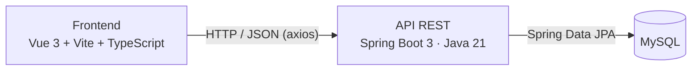

# 🧵 Taller El Punto · Gestión de cursos e inscripciones

Aplicación web full stack para un taller de costura: los instructores publican cursos con sus horarios y productos, y los alumnos se registran, eligen cursos y gestionan sus inscripciones.

Proyecto universitario hecho en equipo con [@aerolinko](https://github.com/aerolinko).

## Qué hace

- **Usuarios**: registro, inicio de sesión y perfil editable.
- **Cursos**: crear, editar y borrar cursos con varios bloques de horario (hora de inicio, hora de fin y días de la semana).
- **Inscripciones**: el alumno ve los cursos de otros autores, selecciona los que quiere y administra sus inscripciones.
- **Productos**: catálogo de productos por autor, con su CRUD completo.

## Arquitectura



| Capa | Tecnologías |
|---|---|
| Frontend | Vue 3 · Vite · TypeScript · Vue Router · Axios · Bootstrap Vue |
| Backend | Java 21 · Spring Boot 3.3 · Spring Web · Spring Data JPA |
| Base de datos | MySQL (también incluye el driver de PostgreSQL) |

El backend sigue una estructura por capas: `controllers` → `services` → `repositories` → `models`.

## API

Todas las rutas cuelgan de `http://localhost:4000/api`.

| Recurso | Endpoints |
|---|---|
| `/user` | `GET /` · `POST /` · `GET /{id}` · `POST /login` · `PUT /{id}` · `DELETE /{id}` |
| `/course` | `GET /` · `POST /` · `GET /{id}` · `GET /author/{id}` · `GET /not/author/{id}` · `PUT /{id}` · `DELETE /{id}` |
| `/inscription` | `GET /` · `POST /` · `GET /{id}` · `GET /owner/{userId}` · `PUT /{id}` · `DELETE /{id}` |
| `/product` | `GET /` · `POST /` · `GET /{id}` · `GET /author/{id}` · `PUT /{id}` · `DELETE /{id}` |

## Correr en local

### 1. Base de datos

Crea una base de datos MySQL llamada `test` (o la que quieras) y define las credenciales:

```bash
export DB_URL=jdbc:mysql://localhost/test
export DB_USER=root
export DB_PASSWORD=tu_contraseña
```

Hibernate crea las tablas solo al arrancar (`ddl-auto=update`).

### 2. Backend (puerto 4000)

```bash
cd backend/Almacen-Datos
./mvnw spring-boot:run
```

### 3. Frontend (puerto 5173)

```bash
cd frontend/almacen-de-datos
npm install
npm run dev
```

## Próximos pasos

- Guardar las contraseñas con hash (BCrypt) y manejar la sesión con tokens (JWT) en lugar de comparar texto plano.
- Validar choques de horario al inscribirse en varios cursos.
- Agregar pruebas de integración para los controladores.
